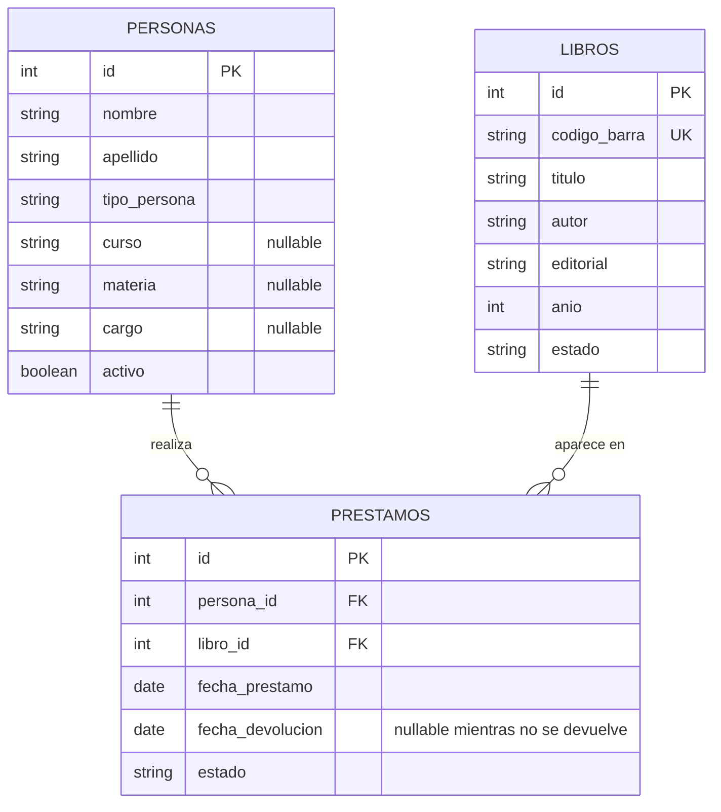

# Diseño de la base de datos

## Alcance

El sistema comienza con tres entidades principales: `personas`, `libros` y `prestamos`. Cada registro de `libros` representa un ejemplar de la biblioteca.

## Diagrama entidad-relación

## Entidades

### `personas`

Representa a toda persona habilitada para retirar libros: alumno, profesor, preceptor, directivo o personal.

| Campo | Descripción |
| --- | --- |
| `id` | Identificador único de la persona (clave primaria). |
| `nombre` | Nombre. |
| `apellido` | Apellido. |
| `tipo_persona` | Categoría de la persona: `ALUMNO`, `PROFESOR`, `PRECEPTOR`, `DIRECTIVO` o `PERSONAL`. |
| `curso` | Curso del alumno; puede ser nulo para otros tipos de persona. |
| `materia` | Materia asociada a un profesor; puede ser nula para otros tipos de persona. |
| `cargo` | Cargo o función; puede ser nulo cuando no corresponda. |
| `activo` | Indica si la persona puede operar en el sistema (`1`) o está inactiva (`0`). |

Los campos `curso`, `materia` y `cargo` son opcionales porque dependen del tipo de persona.

### `libros`

Representa cada ejemplar que posee la biblioteca.

| Campo | Descripción |
| --- | --- |
| `id` | Identificador único del ejemplar (clave primaria). |
| `codigo_barra` | Código usado para localizar el ejemplar; debe ser único. |
| `titulo` | Título del libro. |
| `autor` | Autor o autores. |
| `editorial` | Editorial. |
| `anio` | Año de publicación. |
| `estado` | Situación del ejemplar: `DISPONIBLE`, `PRESTADO` o `BAJA`. |

El código de barras permite identificar un ejemplar escaneado y buscarlo directamente.

### `prestamos`

Registra cada operación de préstamo y vincula una persona con un ejemplar.

| Campo | Descripción |
| --- | --- |
| `id` | Identificador único del préstamo (clave primaria). |
| `persona_id` | Persona que realiza el préstamo (clave foránea a `personas.id`). |
| `libro_id` | Ejemplar prestado (clave foránea a `libros.id`). |
| `fecha_prestamo` | Fecha en que se registra el préstamo. |
| `fecha_devolucion` | Fecha de devolución; queda nula mientras el préstamo siga abierto. |
| `estado` | Situación del préstamo: `PRESTADO` o `DEVUELTO`. |

Al devolver el ejemplar, se registra `fecha_devolucion` y el estado del préstamo pasa a `DEVUELTO`.

## Relaciones y cardinalidad

- Una persona puede tener cero o muchos préstamos; cada préstamo pertenece a una sola persona.
- Un libro puede aparecer en cero o muchos préstamos a lo largo del tiempo; cada préstamo corresponde a un solo libro.
- `prestamos.persona_id` referencia `personas.id` y `prestamos.libro_id` referencia `libros.id`.

## Estados

| Entidad | Valores |
| --- | --- |
| Persona | `activo = 1` (activa), `activo = 0` (inactiva). |
| Libro | `DISPONIBLE`, `PRESTADO`, `BAJA`. |
| Préstamo | `PRESTADO`, `DEVUELTO`. |

## Conservación del historial

No se eliminan físicamente personas ni libros. Cuando una persona deja de usar el sistema, se marca como inactiva (`activo = 0`). Cuando un ejemplar deja de pertenecer a la colección, se marca como `BAJA`. Los préstamos se conservan, incluso después de la devolución, para mantener el historial y permitir consultas como quiénes retiraron un libro durante un período.
